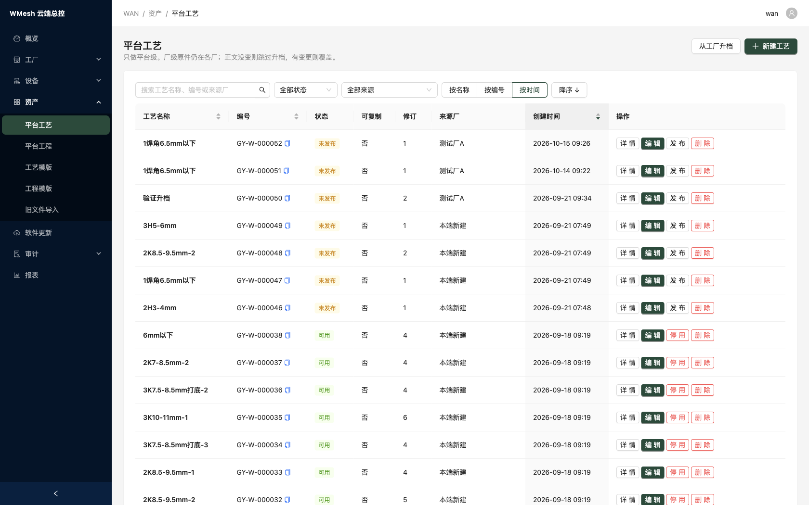
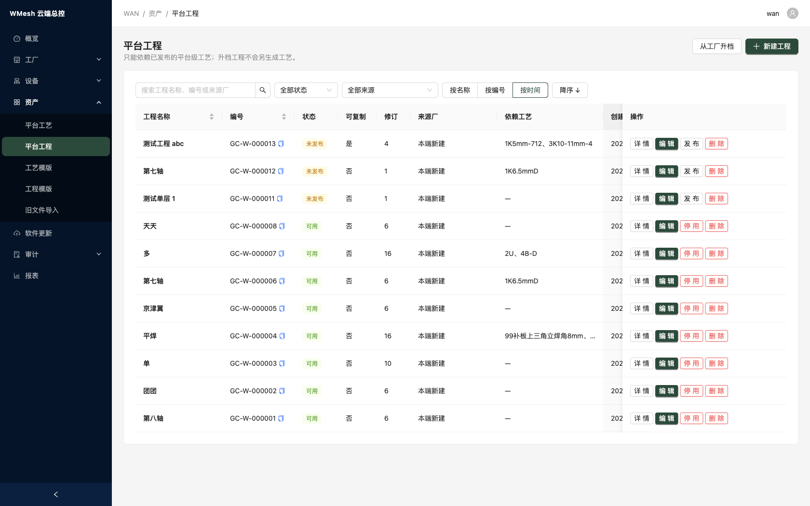
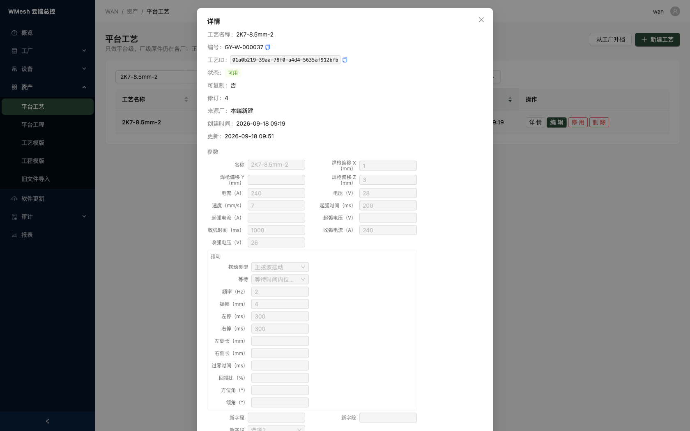
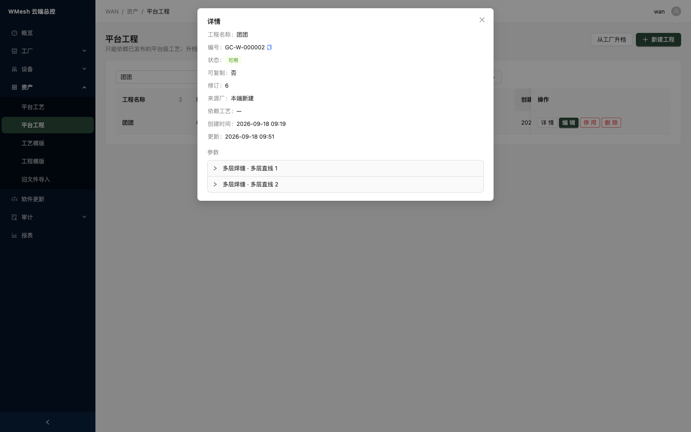
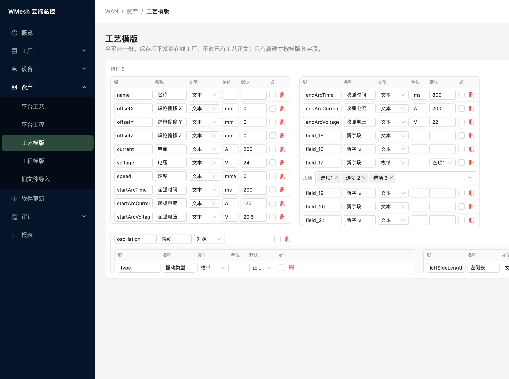
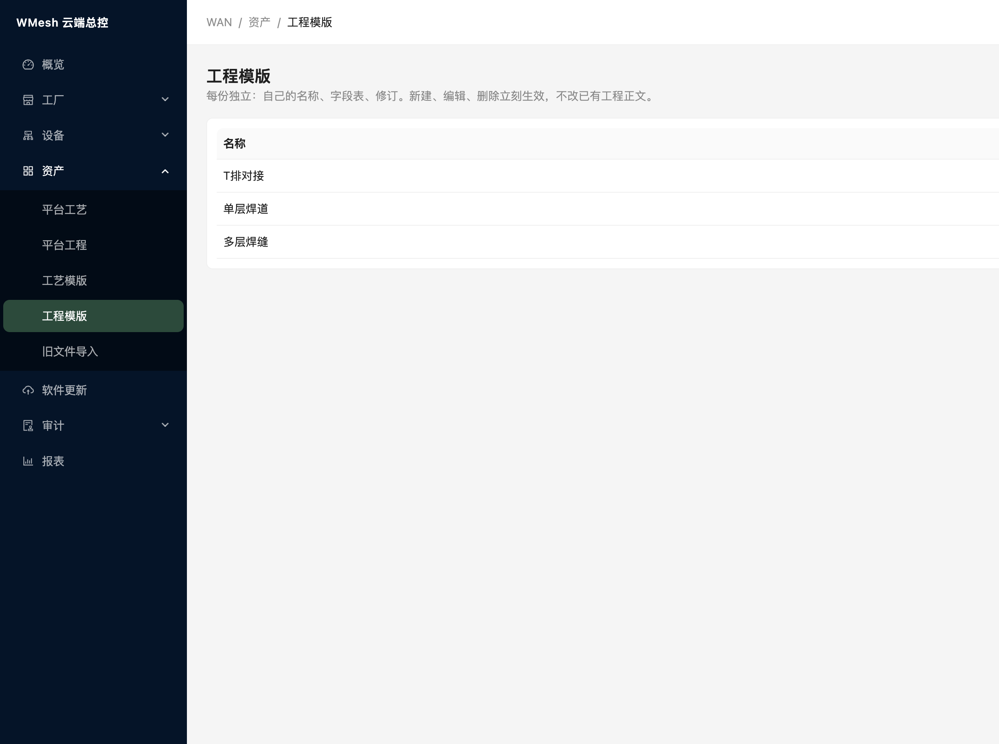
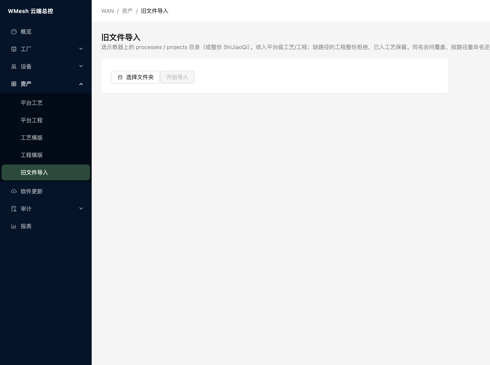
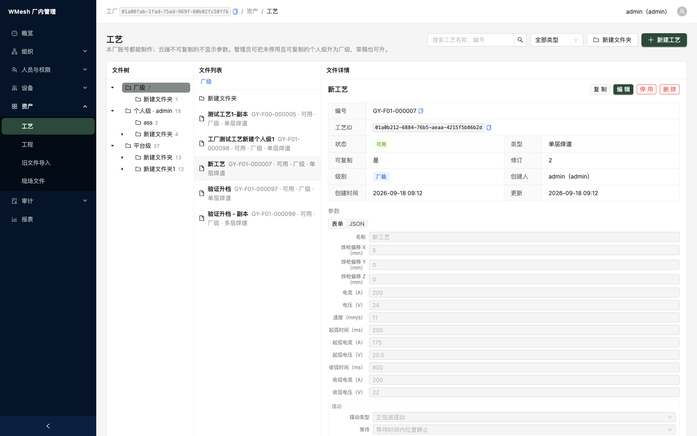
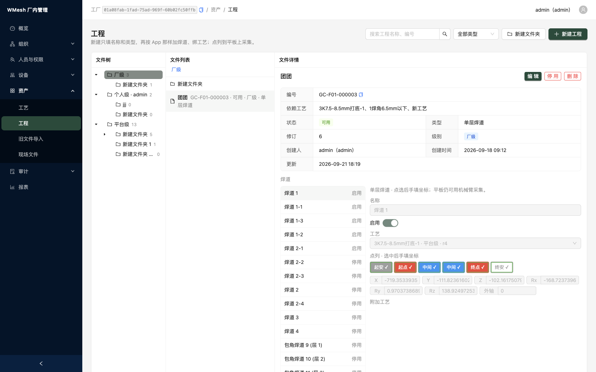
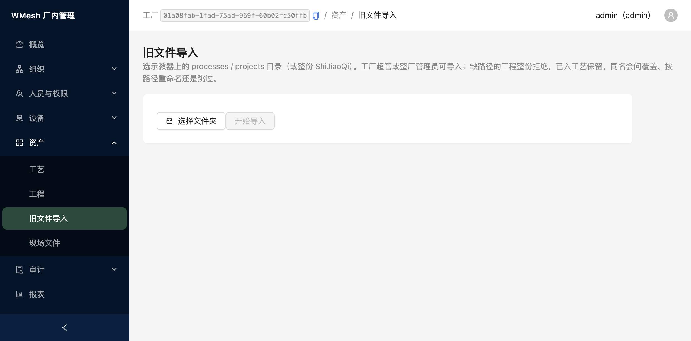

# WMesh 系统介绍（资产为主）

焊接机器人 **云端 + 厂内 + 示教器** 三层协作。本文重点说明 **工艺、工程** 管什么、界面里怎么看 **列表** 与 **文件详情**；账号、设备、报表等只作简述。插图来自测试环境（见下表地址），不含登录、认领等页面。

---

## 测试环境地址

| 入口                           | 地址                        |
| ---------------------------- | ------------------------- |
| 云端管理端 账号 wan 密码 wan-dev-pass | http://154.82.81.16:52080 |
| 厂内管理端 账号 admin 密码 admin123   | http://154.82.81.16:52081 |

---

## 1. 资产要解决什么问题

| 痛点 | 做法 |
| --- | --- |
| 工艺、工程在示教器里按文件夹存，换机就乱 | 每条资产有 **稳定身份与编号**；工程只 **引用工艺身份**，不靠路径 |
| 总部要标准工艺，又怕参数外泄 | **平台 / 厂 / 个人** 三级；**不可复制** 平台工艺对厂内 **不展示参数** |
| 老盘里成百上千条要进系统 | **旧文件导入**：选示教器工艺/工程目录，收成厂级或平台级资产 |
| 厂里做好要上升到全集团 | **升档**：复制出新条目到上一级，**不改** 下级原件 |
| 现场不能常连厂网 | 发布后的资产以 **密文** 下发到示教器；离线仍可焊已授权内容 |

---

## 2. 资产模型（特点）

### 2.1 工艺与工程

- **工艺**：焊接参数配方（电流、电压、摆动等），可复用。
- **工程**：一次焊接作业，含多条 **焊道**；焊道绑 **工艺 ID**，不把参数写进工程里。

### 2.2 三级归属

| 级别 | 谁制作 | 典型用途 |
| --- | --- | --- |
| **个人级** | 示教器 / 个人账号 | 个人库；可复制时可升为厂级 |
| **厂级** | 厂内管理端 / 全厂账号 | 本厂共享；可复制时可升为平台级 |
| **平台级** | 云端 | 跨厂标准；厂内多为只读引用 |

### 2.3 状态与保密

| 状态 | 含义 |
| --- | --- |
| 未发布 | 工艺未发布，不可被工程依赖 |
| 可用 | 已发布，可引用、可参与下发 |
| 已停用 | 不可再改、不可升档 |

- **可复制**（工艺）：允许被上一级 **升档复制**；否则不能升上云。
- **不可复制（平台工艺）**：厂内列表可见名称、状态、修订，**参数正文不可见**（详情里提示「不可复制，不显示工艺参数」）。
- 升档永远是 **新建/覆盖上级副本**，不动下级原件。

---

## 3. 云端：平台工艺与平台工程

侧栏 **资产** → **平台工艺** / **平台工程**。测试云端为 **表格列表 + 行内操作**；点 **详情** 打开 **文件详情** 对话框（只读查看正文；改内容用 **编辑**）。

### 3.1 列表页在看什么

| 区域 | 作用 |
| --- | --- |
| 搜索框 | 按 **名称、编号、来源厂** 模糊查 |
| **全部状态** / **全部来源** | 筛未发布、可用、停用及来源厂 |
| **按名称 / 按编号 / 按时间** + **升序/降序** | 排序 |
| 表头列（工艺） | 工艺名称、编号、状态、可复制、修订、来源厂 |
| 表头列（工程） | 工程名称、编号、状态、可复制、修订、来源厂、**依赖工艺**（列表摘要） |
| 行内 **复制** | 复制编号到剪贴板 |
| **详情** | 打开下文 **文件详情** |
| **编辑** | 改名称与正文（工艺参数 / 工程焊道） |
| **发布** / **停用** | 未发布 → 发布；可用 → 停用 |
| **删除** | 删除条目（以界面权限为准） |
| **从工厂升档** | 选在线工厂，把厂级可复制且已发布的条目升到平台 |
| **新建工艺** / **新建工程** | 在平台级新建 |

页头说明：平台只维护平台副本；厂级原件仍在各厂；升档时正文相同则跳过，有变更则覆盖平台侧。

### 3.2 文件详情（工艺）

列表点 **详情** 后，上半部分是 **元数据**，下半部分是 **参数**（按 **工艺模版** 字段表展示，只读）。

| 字段 | 含义 |
| --- | --- |
| 标题行 | 当前工艺 **显示名** |
| **编号** | 平台工艺编号（如 GY-W-…），可复制 |
| **工艺 ID** | 全局唯一身份，组包与工程引用都认它；可复制完整 ID |
| **状态** | 未发布 / 可用 / 已停用 |
| **可复制** | 是否允许从厂级升上平台 |
| **修订** | 每次保存正文或关键属性递增 |
| **来源厂** | 升档来的显示厂名；本端新建显示「本端新建」 |
| **创建时间** / **更新** | 入库与最后修改时间 |
| **参数** | 模版里的字段：名称、焊枪偏移、电流电压、速度、起弧/收弧、摆动等分组；详情里灰显只读 |

### 3.3 文件详情（工程）

工程详情元数据多一项 **依赖工艺**（本工程登记依赖的工艺 ID 列表）；正文区标题为 **焊道**，按 **工程模版** 展示各焊道及绑定的工艺。

| 字段 | 含义 |
| --- | --- |
| **编号** | 平台工程编号（如 GC-W-…） |
| **依赖工艺** | 依赖登记里的工艺名称/ID 摘要 |
| **状态** / **可复制** / **修订** / **来源厂** / **时间** | 与工艺同类语义 |
| **焊道** | 多条焊道：每层/每段的类型说明；每条焊道选 **工艺 ID**（须为 **可用** 且类型匹配）；不在工程里写工艺参数 |

编辑工程时系统会校验：**焊道引用的工艺 ⊆ 依赖工艺**，且依赖的工艺必须已发布。

### 3.4 工艺模版

全平台 **一份** 工艺字段表；**保存** 后推给在线工厂，**只影响新建与后续编辑**，不改已有工艺正文。

支持维护字段键、显示名、类型、单位、默认值、必填；可导出/导入 JSON。

### 3.5 工程模版

多份独立模版（如单层焊道、多层焊缝、T 排对接）；**新建/改模版** 立刻生效，**不** 改写已有工程正文。

### 3.6 旧文件导入（平台级）

选示教器 **工艺目录、工程目录或整盘根目录** → 预览 → **开始导入**。缺路径的工程整份拒绝；同名可选覆盖、按路径改名或跳过。

### 3.7 从工厂升档

在工艺或工程列表点 **从工厂升档**：选 **在线工厂**，表格列出可升档的厂级条目，逐条 **升档**。仅 **可复制、已发布、未停用** 等条件满足的才会出现（以界面为准）。

---

## 4. 厂内：工艺与工程

侧栏 **资产** → **工艺** / **工程**。厂内为 **文件树 + 文件列表 + 文件详情** 三栏：左树按 **厂级 / 个人 / 平台** 分目录，中栏点一条文件，右栏 **文件详情** 与云端 **详情** 同源信息（字段略有增减）。

### 4.1 列表与中栏

- 搜索 **名称、编号**；可按 **焊接类型**（单层焊道等）筛选。
- **新建文件夹** 整理目录；**新建工艺/工程** 落在当前目录。
- 中栏行上可见 **编号、状态、类型** 等摘要。

### 4.2 文件详情（与云端对照）

右栏标题 **文件详情**，字段与云端详情对话框一致，厂内额外常见：

| 字段 | 说明 |
| --- | --- |
| **级别** | 个人级 / 厂级 / 平台（引用） |
| **创建人** | 本厂人员 |
| **工艺 ID** / **依赖工艺** | 同云端 |
| **参数**（工艺） | 按工艺模版；**不可复制平台工艺** 显示「不可复制，不显示工艺参数」 |
| **焊道**（工程） | 按工程模版；工程不保密，厂内可看焊道与绑定工艺 |

行内或详情旁常见：**发布/停用**、**设可复制**、**升档为厂级**（个人→厂，管理员）、**复制** 等（以界面为准）。

### 4.3 旧文件导入（厂级）

**工厂超管** 或 **整厂管理员** 可用；结果为 **厂级** 资产，规则与云端类似。

### 4.4 现场文件

Client 上传的点云、图片等在厂内浏览；本体在厂内对象存储，**不上云**。

---

## 5. 资产相关典型流程

| 目标 | 步骤 |
| --- | --- |
| 老盘进厂 | 厂内 **旧文件导入** → 检查拒绝项 → 发布要用的工艺 |
| 统一集团工艺 | 厂内维护 **可复制** 厂级工艺并发布 → 云端 **从工厂升档** |
| 示教器能用上 | 厂内 **发布** → 操作员在示教器同步 → 工位连臂作业 |
| 个人工艺共享 | 个人级 → **升档为厂级** → 再按需升平台 |
| 看清一条资产 | 列表 **详情** 或厂内点文件 → 看元数据 + **参数/焊道** |

---

## 6. 其它能力（简略）

| 模块 | 一句话 |
| --- | --- |
| **工厂** | 云端建工厂、发建厂码；厂内认领激活。 |
| **账号组织** | 厂内超管建人、组织、角色；云端不管厂内密码。 |
| **设备** | 云端登记并分给厂；厂内签发 **运行许可**；与资产下发配合。 |
| **软件更新** | 云端发安装包，厂/客户端拉取，与资产正文分开。 |
| **报表** | 厂内按工程/人/组织看焊次；云端跨厂汇总，不含人员明细。 |
| **示教器** | 厂网同步密文 → 机械臂 WiFi 作业；工艺磁盘无明文。 |

---

*菜单与占位以当前版本为准；列表与详情布局若与插图略有差异，以你登录的环境为准。*
